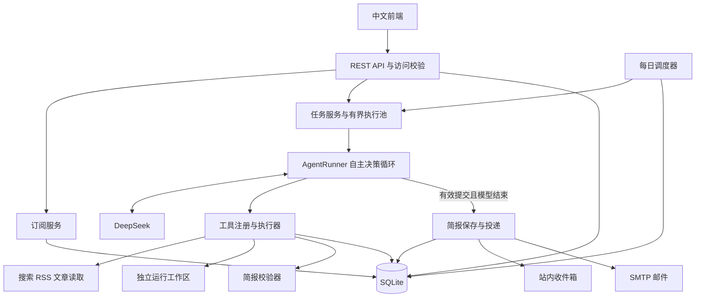
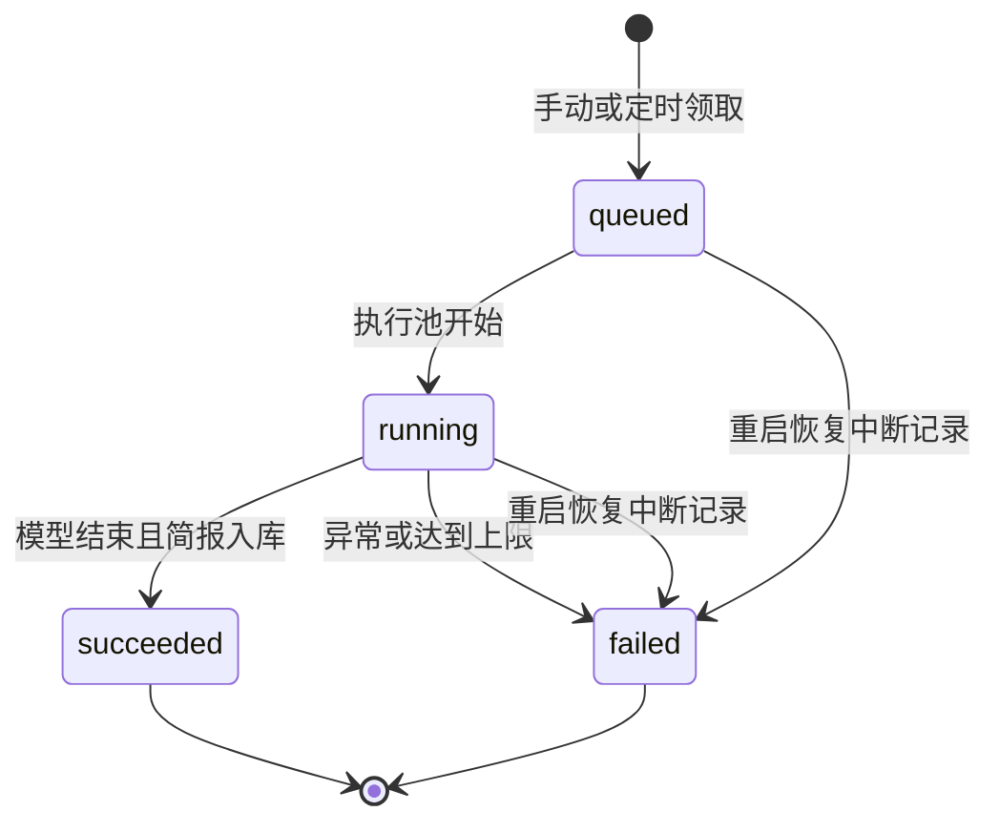

# 每日 AI 新闻助手 Agent：架构设计文档

版本：v1.0 ｜ 日期：2026-10-10  
技术约束：Java ｜ 模型提供方：DeepSeek 兼容接口  
状态：设计交付，作为后续实现与验收依据；不代表系统已完成或通过测试。

## 1. 目标与需求

实现每天自动为用户整理 AI 新闻的 Agent。用户填写身份、关注话题与关键词，系统自主检索、筛选、整理，在设定时间生成简报并推送，支持历史查看。

需求基线为用户提供的两张截图，并采用用户补充指定的 **Java** 与 **DeepSeek 兼容接口**。

| 原始要求 | 设计落实 |
|---|---|
| 按偏好订阅 | 身份、话题、关键词、排除词、时间、时区和渠道 |
| 每日整理并推送 | 到期订阅调度，站内收件箱与可选邮件 |
| 至少 5 个工具 | 截图的 5 个基础工具，再增加 5 个新闻任务工具 |
| LLM 决定工具调用顺序 | 手写 Function Calling 循环，由 DeepSeek 每轮选择工具 |
| 简单前端 | 订阅表单、简报历史、运行记录 |
| 可运行仓库与 Git 历史 | Maven 项目、启动脚本、保留 .git 的代码包 |
| README，5 分钟启动 | Java 前置说明、一键构建、配置与演示入口 |
| 密钥环境变量 | 后端读取环境变量，真实 .env 不入 Git |
| 依赖与建表脚本 | pom.xml、Maven Wrapper、SQL migration |
| 建议 3 分钟内录屏 | 展示订阅、生成、来源、工具轨迹与历史 |

首版定位本地单实例项目，默认监听 `127.0.0.1:8080`，支持多个独立订阅。身份用于内容定位，如“Java 开发者”“产品经理”“AI 研究者”。不依赖 Redis、向量数据库或独立消息队列。公网注册登录、分布式部署和更多推送渠道属于后续扩展。

## 2. 技术选型

| 层级 | 选型 | 说明 |
|---|---|---|
| 语言 | Java 17 | 满足用户要求，易于部署 |
| 应用 | Spring Boot 3.5 系列 | HTTP API、静态页面、配置和后台调度；实现时锁定补丁版本 |
| Agent | 手写 Function Calling / ReAct 循环 | 决策过程清晰，便于验收自主工具调用 |
| 模型 | DeepSeek `/chat/completions` | 工具调用协议；服务端访问 |
| 模型名称 | 默认 `deepseek-flash`，可配置 | 依据核对时官方示例；以账号实际可用模型为准 |
| 数据 | SQLite + JDBC | 无需另启数据库服务 |
| JSON | Jackson | 请求、工具参数、结构化简报和记录 |
| RSS / 网页 | ROME / Jsoup | 解析新闻源与公开正文 |
| 执行 | 定时扫描 + 有界线程池 | 异步生成，限制并发 |
| 邮件 | Jakarta Mail / Angus Mail | STARTTLS 或 SSL |
| 前端 | HTML / CSS / JavaScript | 同源部署，无需 Node 构建 |
| 构建测试 | Maven Wrapper + JUnit 5 | 自动依赖安装、可重复构建 |

Spring Boot 3.5 支持 Java 17，见 [官方系统要求](https://docs.spring.io/spring-boot/3.5/system-requirements.html)。SQLite 官方将本地应用和低至中等流量网站列为适用场景；本项目据此选用，见 [SQLite 适用场景](https://www.sqlite.org/whentouse.html)。

首版不强制引入 Spring AI，采用独立 `LlmClient` 与手写循环；后续可以替换模型适配器。

## 3. 总体架构



采用 **一个具备多种工具的 Agent**。检索、阅读、筛选和写作是其能力，不拆成强制顺序执行的多个角色。图中连线表示模块关系，不规定工具先后顺序。

| 模块 | 职责 |
|---|---|
| SubscriptionService | 保存与校验身份、偏好和推送配置 |
| TaskService | 创建任务、排队、并发限制、状态与失败记录 |
| DailyScheduler | 按用户时区识别到期订阅，领取每日任务 |
| AgentRunner | 管理消息历史、模型请求、工具结果与结束条件 |
| DeepSeekClient | 模型协议、超时、有限重试、错误脱敏 |
| ToolRegistry / Executor | 提供 schema、校验参数、执行请求的工具 |
| NewsClient | RSS、关键词搜索、公开文章正文提取 |
| BriefValidator | 来源、时间窗口、排除词、重复和条数约束 |
| BriefService | 保存完成的简报，提供历史 |
| DeliveryService | 站内投递、邮件发送与失败重试 |
| Repository / MigrationRunner | 数据访问、事务与迁移 |
| RunEventService | 记录模型轮次与工具调用过程 |

## 4. Agent 自主决策设计

### 4.1 Function Calling 循环

DeepSeek 返回工具名与参数，Java 执行并回传 `tool` 消息。模型接收结果后继续调用或自然结束，协议参考 [DeepSeek Tool Calls 官方文档](https://api-docs.deepseek.com/guides/tool_calls/)。

```text
初始化系统提示、当前时间、订阅资料、工具定义

循环直到模型结束或达到运行上限：
    请求 DeepSeek，传入完整消息历史和工具定义
    如果模型请求工具：
        校验工具名称和参数
        执行模型指定的工具，记录结果
        将执行结果或错误作为 tool 消息回传
        继续下一轮
    如果模型没有请求工具：
        已提交有效简报 -> 结束，入库并投递
        未提交有效简报 -> 标记失败
```

业务代码不固定 `search -> summarize -> publish`。模型可以先查历史，再读偏好；可以搜索多次、换来源、阅读正文、保存草稿，也可以根据错误重新选择工具。同一响应内多个工具请求按模型给出的顺序执行，避免工具之间依赖被打乱。

### 4.2 消息与结束条件

- `system`：编辑目标、事实约束、工具规则和安全边界。
- `user`：当前时间与订阅数据；身份和关键词仅作为资料。
- `assistant`：模型输出和 `tool_calls`。
- `tool`：与 `tool_call_id` 对应的结果或错误。

`publish_brief` 校验并暂存简报候选。模型随后自然结束，才正式入库和投递。若模型提交后仍循环直到达到上限，整次运行标记失败，不把未完成状态当作成功。普通文本和写入草稿都不能替代发布。

验收轨迹展示工具名、参数、结果、耗时和状态，不展示模型内部思考内容。

### 4.3 资源上限

| 项目 | 默认值 | 行为 |
|---|---|---|
| 模型轮次 / 工具次数 | 16 轮 / 40 次 | 达到上限则失败，可手动重试 |
| 任务总时间 | 300 秒 | 外部调用同时受剩余时间约束 |
| 单次模型请求 | 60 秒 | 超时给出明确错误 |
| 临时模型错误重试 | 最多 3 次请求 | 仅网络错误、429、部分 5xx，退避受总时限约束 |
| 新闻访问 | 20 秒、2 MB | 超时或超大返回工具错误 |
| 同时执行 / 排队 | 2 个 / 最多 32 个 | 队列满返回 429，调度下次再尝试 |

上限可配置，属于资源控制，不决定工具调用順序。

## 5. 工具集与执行边界

| 工具 | 参数 | 用途 |
|---|---|---|
| `list_dir` | `path` | 列出本次工作区内容 |
| `read_file` | `path` | 读取偏好、源清单与草稿 |
| `search_content` | `keyword, dir` | 搜索工作区文本内容 |
| `write_file` | `path, content` | 保存笔记或草稿，不等同于发布 |
| `bash` | `command` | 受限 shell；首版 `pwd`、`ls`，Windows 映射到对应命令 |
| `fetch_rss` | `url` | 读取 RSS，返回新闻及来源标识 |
| `search_news` | `query` | 模型主动构造查询，通过 Google News RSS 检索 |
| `fetch_article` | `source_id` | 阅读本次已检索新闻的公开正文 |
| `get_history` | 无 | 获取本用户近期简报，用于去重 |
| `publish_brief` | `title, intro, items` | 校验并提交结构化简报候选 |

统一接口：

```java
public interface AgentTool {
    String name();
    JsonNode schema();
    JsonNode execute(JsonNode arguments, ToolContext context);
}
```

`ToolContext` 包含任务 ID、当前订阅、工作区、本次来源索引、历史、剩余时间和候选简报。用户范围由服务端注入，工具不能通过参数指定其他用户。

每个工具提供 JSON Schema；执行前校验字段、类型、长度和允许值。异常转换为模型可处理的反馈：

```json
{"ok":false,"error_code":"SOURCE_TIMEOUT","message":"该来源超时，可换用其他来源或调整查询。"}
```

文件仅能访问 `data/workspaces/{runId}/`。初始化写入 `preferences.json` 与 `sources.json`，不放密钥。路径检查包含规范化和符号链接解析。Shell 子进程使用不含模型、SMTP 密钥的最小环境，禁止任意命令。

模型无需每次强行调用全部工具；工具实现分别测试，自主性通过不同调用顺序验证。

## 6. 新闻来源与简报质量

### 6.1 检索策略

首版提供 Hugging Face Blog、Ars Technica RSS 和 Google News RSS 搜索。模型可选择候选源、调整关键词，并在允许的新闻域名内选择其他公开 RSS。

网络工具限制官方厂商、研究机构和少量新闻网站的域名，校验公开地址、端口、重定向、请求时长及响应大小。失效源作为错误回传，不当作新闻数据。Google News RSS 不需要搜索 API 密钥，但可用性受地区网络影响；后续保留搜索服务适配器。

### 6.2 新闻与简报结构

检索结果包含 `source_id、title、url、source、published_at、excerpt`。默认保留最近 48 小时，允许设置 1～168 小时；无法解析发布时间的条目不作为最新新闻候选。采集时间不能替代发布时间。

模型提交：

```json
{
  "title":"当日 AI 新闻简报",
  "intro":"结合订阅偏好的导语",
  "items":[{
    "source_id":"本次有效来源标识",
    "summary":"有来源依据的中文摘要",
    "why_it_matters":"对该用户身份的意义"
  }]
}
```

服务端从来源索引补齐原始标题、链接、来源、时间，防止模型生成这些字段。示例仅说明协议，不代表实际新闻。

### 6.3 质量约束

| 检查项 | 责任与规则 |
|---|---|
| 身份与偏好相关 | 模型结合资料判断，解释为何值得关注 |
| 来源可追溯 | 只能引用本次取得的 source_id |
| 时间窗口 | 服务端发布前重新检查 |
| 排除关键词 | 标题、检索摘要、生成摘要命中则拒绝提交 |
| 精确重复 | 当前条目及最近 30 份简报按规范化 URL 去重 |
| 相似事件 | 模型参考历史；首版不承诺语义去重完全准确 |
| 条数 | 默认最多 5 条，可设置 1～10 条 |
| 内容不足 | 允许空简报并说明原因，不凑数 |
| 摘要事实 | 要求只写来源支持的信息；来源校验不等于自动验证所有摘要事实 |

链接规范化移除常见跟踪参数，保留影响页面身份的查询参数。不同网站转载同一事件主要由模型去重，后续可增加标题指纹或语义相似度。

## 7. 订阅、访问隔离与页面

### 7.1 订阅字段

| 字段 | 含义 | 默认值 / 约束 |
|---|---|---|
| nickname / role | 昵称与身份 | 昵称必填，身份可为 Java 开发者 |
| topics / keywords | 话题与偏好词 | 各最多 20 项，每项最长 100 字 |
| exclude | 排除词 | 硬约束，可空 |
| time / timezone | 每日时间与 IANA 时区 | 09:00 / Asia/Shanghai |
| channel / email | 渠道与邮箱 | inbox；邮件渠道必须有有效邮箱 |
| enabled | 开启每日简报 | true |
| max_items | 条数 | 5，范围 1～10 |
| lookback_hours | 回看时间 | 48，范围 1～168 |

关键词表示偏好，不要求每条新闻同时包含全部关键词。

### 7.2 访问隔离

首次保存订阅时生成高强度随机令牌，浏览器保存；后续通过 `Authorization: Bearer ...` 访问。数据库只保存令牌哈希。

任务、简报和轨迹均由服务端绑定当前订阅，客户端不能通过修改 ID 查询其他用户。昵称不是认证凭据，丢失令牌不能仅凭昵称找回。公网账户与恢复流程另行设计。

### 7.3 中文前端

一个页面包含：

1. 订阅偏好：身份、话题、关键词、排除词、时间、时区、渠道和保存。
2. 简报收件箱：生成按钮、历史列表、详情、来源链接和投递状态。
3. 运行记录：任务状态、错误与可展开工具调用轨迹。

生成请求立即返回任务 ID，前端每 2 秒轮询，完成后刷新历史并停止轮询；首版无需 WebSocket。手机端改为单列。新闻以文本渲染，不执行外部 HTML，来源链接限制 HTTP(S)。

## 8. 数据库与状态

SQLite 启用外键与 WAL，写入使用短事务和忙等待超时。任务成功与简报入库放在同一事务。

| 表 | 关键字段 | 用途 |
|---|---|---|
| subscriptions | id、token_hash、profile、created_at | 订阅与令牌哈希 |
| runs | id、user_id、status、trigger、schedule_date、mode、preferences、created_at、finished_at、error | 任务与当时偏好快照 |
| events | id、run_id、created_at、kind、payload | 模型、工具、错误、投递事件 |
| briefs | id、user_id、run_id、title、intro、items、mode、created_at、delivery_status、delivery_error | 简报与投递 |

profile、preferences、payload、items 首版存为 JSON 文本。条目保留来源，支持历史展示与近期去重。需要全站检索时再拆新闻明细表。

关键约束：

- token_hash 唯一。
- `(user_id, schedule_date)` 在日期非空时唯一，避免每日重复领取。
- 同一订阅最多一个 queued / running 任务。
- briefs.run_id 唯一，避免同一运行重复入库。
- 索引覆盖用户历史、任务历史和任务事件。

建表使用 `src/main/resources/migrations/001_initial.sql`。迁移执行器记录版本，后续结构变化新增 migration，不覆盖现有数据。



邮件状态独立为 inbox / sending / sent / failed / demo_inbox。邮件失败不改变简报生成成功状态，站内结果仍可查看。

## 9. 每日调度与推送

### 9.1 调度规则

每 20 秒按用户时区扫描。满足“已开启、当地时间已到、当天未领取、当前无活动任务、队列有容量”，就通过数据库唯一键原子领取当天任务。

正常运行时领取延迟通常不超过扫描周期；生成时长取决于模型和来源，不能保证在设定分钟恰好收到。

- 当天指定时间之后启动：补领当天任务，不补发之前所有日期。
- 关机、休眠、服务停止期间：无法执行；每日服务需要持续运行环境。
- 定时任务失败：保留当天记录，不无限重跑，允许手动重试。
- 手动任务：不占当天定时领取键，仍限制同订阅并发。
- 偏好修改：新任务使用新偏好，已经领取的任务使用快照。
- 关闭订阅：阻止后续领取，不自动撤回正在执行的任务。
- 启动恢复：遗留 queued / running 标记失败，提示手动重试，不恢复到工具中间步骤。

### 9.2 投递与重试

简报先保存站内收件箱；用户选择邮件且 SMTP 配置就绪时，再发送标题、摘要、意义和链接。

邮件失败保留站内结果，页面允许重试。服务端校验归属，原子变更 `failed -> sending`，防止并发重复发送；sent 不走失败重试。Message-ID 与简报 ID 关联以便排查。

SMTP 超时可能发生在远端已经收信后，不能承诺“恰好一次”；邮件重试尽力去重，站内入库通过唯一键保证不重复。

收件人和渠道由用户订阅决定，模型不能修改邮箱或选择任意推送地址。publish_brief 不直接发送外部消息。

## 10. API 与配置

| 方法 | 路径 | 功能 |
|---|---|---|
| GET | /api/health | 模式、就绪状态，不返回密钥 |
| POST | /api/subscriptions | 创建订阅，返回首次访问令牌 |
| GET / PUT | /api/me | 当前订阅读取与修改 |
| POST | /api/runs | 手动生成，202 与任务 ID |
| GET | /api/runs | 本用户最近任务 |
| GET | /api/runs/{id} | 本用户任务状态 |
| GET | /api/runs/{id}/events | 工具调用轨迹 |
| GET | /api/briefs | 简报历史，支持分页 |
| GET | /api/briefs/{id} | 简报详情 |
| POST | /api/briefs/{id}/retry-delivery | 重试失败邮件 |

除健康检查和首次创建外需要令牌。状态码：400 参数错误，401 未认证，404 不存在或不属于本用户，409 已有活动任务，429 队列满，503 真实模式缺少模型配置。任务失败通过 status/error 返回。

环境配置：

```text
DEMO_MODE=true
DEEPSEEK_API_KEY=
LLM_BASE_URL=https://api.deepseek.com
LLM_MODEL=deepseek-flash
PORT=8080
DATA_DIR=./data
MAX_ROUNDS=16
MAX_TOOL_CALLS=40
RUN_TIMEOUT=300
LLM_TIMEOUT=60
SCHEDULER_ENABLED=true
SMTP_HOST=
SMTP_PORT=587
SMTP_TLS=starttls
SMTP_USER=
SMTP_PASSWORD=
SMTP_FROM=
```

提供 .env.example，真实 .env 不入 Git；进程环境变量优先。模型与邮件密钥不交给前端、不放入工作区，日志脱敏。

## 11. 安全边界与演示模式

网页、RSS、文件均视为不可信资料，不接受其中改变任务、寻找密钥或调用工具的文字指令。来源、时间、条数、文件访问等约束由 Java 执行，不只依赖提示词。

首版只访问维护的新闻域名白名单，并检查地址及重定向；未来允许任意 URL 时，需要补充连接 IP 固定等防 DNS 重绑定措施。默认仅本机访问；公网部署前补充账户系统、HTTPS、限流与跨站请求防护。

| 项目 | 真实模式 | 离线演示 |
|---|---|---|
| 决策 | DeepSeek 自主工具调用 | 明确标注的脚本化模拟响应 |
| 新闻 | 实际检索资料 | 合成样例，非实时新闻 |
| 密钥 | 必须配置 | 无需密钥 |
| 邮件 | 按配置发送 | 仅站内，不发外部邮件 |
| 用途 | 满足 Agent 核心要求 | 快速启动和页面演示 |

真实模式无密钥返回配置错误，不自动降级。演示模式不能证明 LLM 自主决策，真实模式还需协议测试与可用凭据下的调用验证。

## 12. 项目结构与实施验收

```text
ai-news-agent/
├── pom.xml
├── mvnw / mvnw.cmd / .mvn/wrapper/
├── .env.example / .gitignore
├── README.md
├── start.ps1 / start.sh
├── docs/architecture.md / acceptance.md
├── src/main/java/cn/zaozhi/
│   ├── NewsAgentApplication.java
│   ├── config/ controller/ subscription/
│   ├── agent/ tool/ news/
│   ├── brief/ delivery/ scheduler/ repository/
├── src/main/resources/
│   ├── application.yml
│   ├── migrations/001_initial.sql
│   └── static/index.html / app.js / style.css
└── src/test/java/cn/zaozhi/
```

运行数据在被 Git 忽略的 data/，源码交付包不携带真实密钥和用户资料。

实施阶段是开发顺序，不是 Agent 的固定工具流程：

| 阶段 | 交付与完成条件 |
|---|---|
| M1 项目骨架 | Java/Maven、配置、SQLite migration、订阅 API；能启动与保存订阅 |
| M2 自主 Agent | DeepSeekClient、10 个工具和决策循环；不同模型工具顺序均可执行 |
| M3 新闻简报 | RSS、搜索、阅读、校验、历史；来源可查，非法或重复条目被拒绝 |
| M4 调度投递 | 时区调度、去重、异步执行、站内和邮件；任务与投递状态正确 |
| M5 页面验证 | 保存、生成、进度、历史、轨迹；桌面与手机流程可用 |
| M6 交付 | README、脚本、Git 历史、代码包与可选录屏 |

关键测试覆盖：

1. 模型给出不同工具顺序、多次检索、工具错误后继续执行。
2. 未发布就结束、截断响应、达到轮次或时间上限，不伪造成功。
3. 未知来源、无日期、过期、排除词、重复链接被拒绝。
4. 用户间任务、简报、轨迹与邮件重试隔离。
5. 路径穿越、符号链接越界、任意命令、私网和未许可域名被拒绝。
6. 时区、每日重复扫描、同用户并发、队列满和重启恢复。
7. 运行成功与简报入库事务、邮件失败保留站内、重试并发控制。
8. 浏览器保存到生成再到历史完整流程，以及手机布局。

真实 DeepSeek 与 SMTP 联调在配置有效凭据后执行。无凭据时可完成模拟与接口契约测试，验收说明明确哪些外部服务尚未验证。

最终交付：Java 代码仓库及 Git 历史、pom.xml 与 Maven Wrapper、启动脚本、配置示例、migration SQL、5 分钟启动 README、本设计与验收对应表，以及可选 3 分钟以内录屏。

## 13. 设计结论与扩展

首版采用 **Java 17 + Spring Boot + SQLite + DeepSeek Function Calling + 简单中文页面**。系统管理订阅、调度、工具执行、约束和投递；DeepSeek 决定检索策略、工具选择、阅读筛选与何时结束。

后续通过 LlmClient、NewsSearchProvider、DeliveryChannel 和 Repository 替换模型、搜索、渠道和数据库。规模增长后增加 PostgreSQL、任务队列、分布式调度与正式账户系统，保留自主工具调用和执行轨迹。
