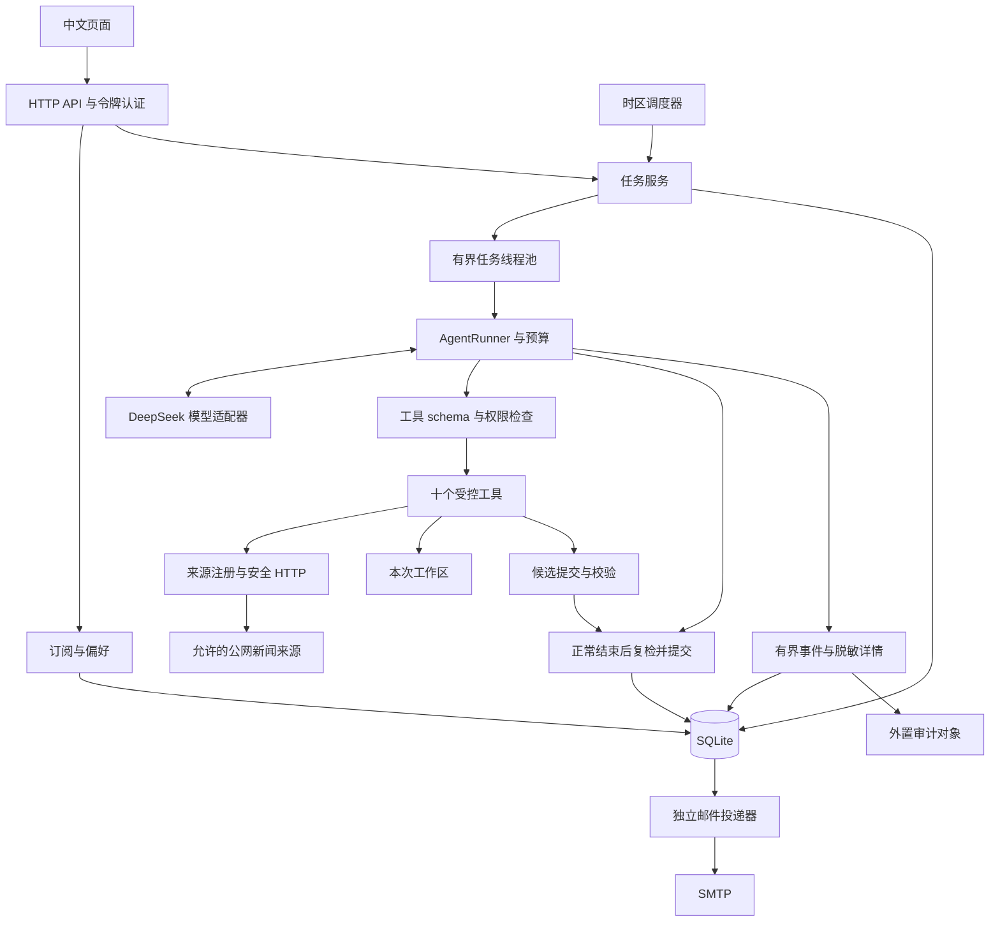
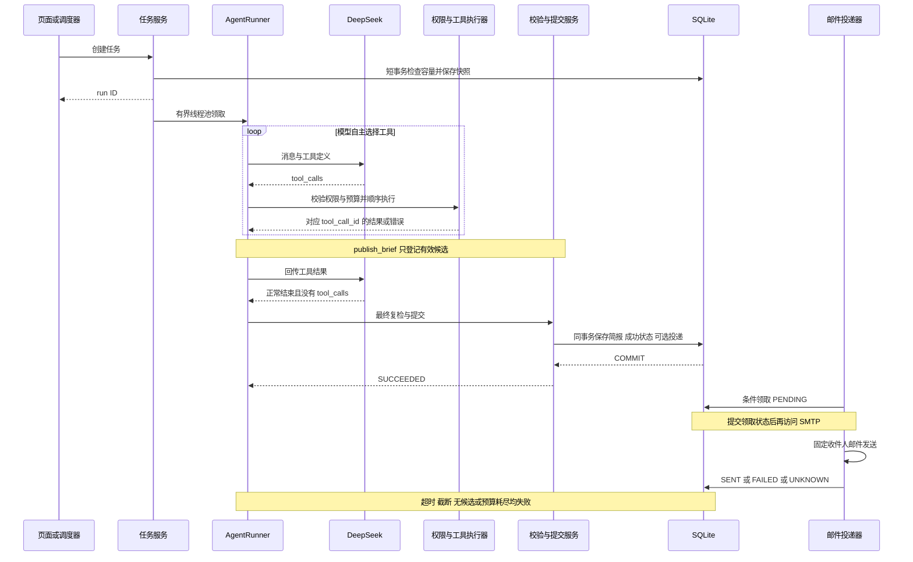
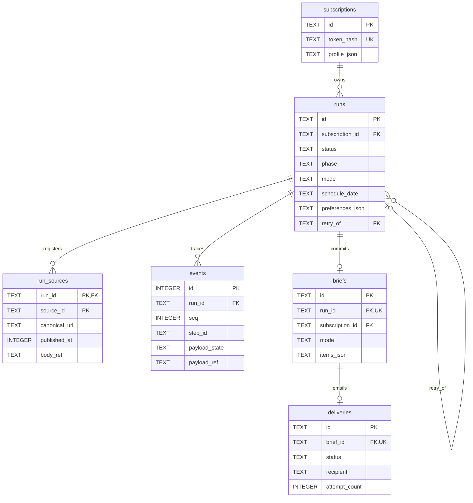
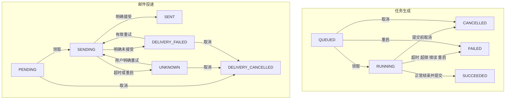

# 每日 AI 新闻助手 Agent 设计图

四图对应架构 v1.1。图形预览见 `diagrams.html`，可编辑 Mermaid 源码在 `diagrams/`。连线表示职责与数据联系，不规定新闻工具的调用顺序。

## 1 总体架构

模型经工具执行层访问业务能力；权限、预算和提交由服务端控制。SQLite 同时保存业务状态和待投递记录，首版不依赖独立消息队列。

## 2 执行时序

工具调用可以反复、改顺序和处理失败。图中模型正常结束后的提交是必须经过的业务关口；并非所有模型都会执行相同新闻工具序列。

## 3 数据库关系

首版以订阅为身份主体。简报通过 `(run_id, subscription_id, mode)` 复合外键与运行一致；事件直接属于运行，不属于简报。一个运行至多有一份简报，一份简报至多有一条 EMAIL 投递记录。retry_of 指向相同订阅与模式的旧运行。

## 4 状态机

生成与投递是独立状态机；生成的 phase 不改变活动任务判断。图中 DELIVERY_FAILED 和 DELIVERY_CANCELLED 分别对应 deliveries 表的 FAILED 与 CANCELLED。UNKNOWN 不自动重发。重启旧活动任务失败；已经成功提交的简报不回退。

